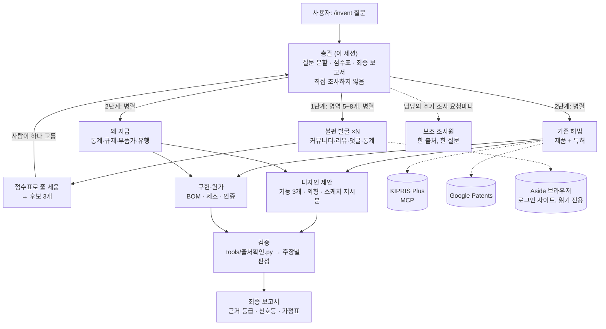

# 발명 조사 시스템 · Invention Research Pipeline

[](https://github.com/jasmin0202/patent/actions/workflows/test.yml)
[](LICENSE)

"욕실용품 하나 기획해봐" 같은 넓은 질문을 받으면, 에이전트 7개가 커뮤니티·리뷰·특허·통계·쇼핑몰을 나눠 뒤지고, **모든 주장에 출처와 근거 등급을 붙인** 제품 기획 보고서를 만든다. Claude Code 위에서 돌아가는 멀티 에이전트 파이프라인이다.

**English summary.** A multi-agent research pipeline built on Claude Code. An orchestrator splits a vague product question into life-scene domains, fans out seven specialist agents (pain discovery, prior art incl. patents, why-now, design, cost, verification, one-shot digger), ranks candidates with a weighted rubric, and writes a report in which every claim carries a source URL and an evidence grade (3+ independent sources = confirmed). A standard-library Python tool mechanically re-opens every cited URL, cross-checks patent numbers against their links, and tests whether quoted sentences actually appear on the cited page. Korean patents are searched live through a KIPRIS Plus MCP server. See [examples/](examples/2026-10-23-bathroom) for a real end-to-end run.

---

## 무엇이 문제였나

LLM에게 "시장 조사해 줘"라고 하면 그럴듯한 문장이 나온다. 문제는 그 문장이 **어디서 왔는지 모른다**는 것이다. 없는 특허번호를 만들고, 한 사람의 댓글을 시장 전체의 불만처럼 쓰고, 출처 링크가 죽어 있어도 모른다. 이 프로젝트는 그 세 가지를 구조로 막는다.

| 흔한 실패 | 이 시스템의 장치 |
|---|---|
| 출처 없는 주장 | 출처 없는 문장은 "미확인" 등급. 보고서의 모든 줄에 등급이 붙는다 |
| 지어낸 특허번호 | 검색 결과·API 응답에서 복사한 번호만 허용. 검증 단계에서 번호와 링크를 기계 대조 |
| 과장된 일반화 | 독립 출처 3개 이상이어야 "확인됨". 같은 글의 댓글, 같은 글의 다른 URL은 1개로 센다 |
| 죽은 링크 | 검증 도구가 모든 URL을 실제로 열어 열림/닫힘/차단 의심을 표시 |
| 끝없는 조사 | 담당별 검색 횟수 상한. 상한에 닿으면 멈추고 "못 한 조사"에 적는다 |

## 아키텍처



역할 7개는 각각 `.claude/agents/*.md` 한 파일이다. 파일마다 "답하는 질문 하나, 입력, 절차, 출력 양식, 규칙"만 적혀 있다. 총괄 절차는 [`.claude/skills/invent/SKILL.md`](.claude/skills/invent/SKILL.md), 총괄이 지키는 규칙은 [`CLAUDE.md`](CLAUDE.md)에 있다.

## 설계 결정 세 가지

**1. 총괄은 조사하지 않는다.** 총괄이 직접 검색을 시작하면 컨텍스트가 조사 결과로 가득 차서 판단이 흐려진다. 총괄은 질문을 쪼개고, 담당을 띄우고, 돌아온 파일을 점수표로 줄 세우는 일만 한다. 담당은 서로를 모르고, 결과는 전부 파일로만 주고받는다. 서브에이전트가 서브에이전트를 못 띄우는 제약 때문에 "보조 조사원"은 담당이 요청을 돌려주면 총괄이 대신 띄운다.

**2. 근거 등급은 올릴 수 없고 내릴 수만 있다.** 담당이 "확인됨"이라고 써도 검증 담당이 독립 출처 3개를 못 세면 "추정"으로 내린다. 반대 방향은 없다. 담당마다 등급 기준을 제멋대로 적는 일이 실제로 생겨서([예시](examples/2026-10-23-bathroom/01-불편-습기환기.md)의 머리글 참고) 기준을 `rubric/점수표.md` 하나로 고정하고 검증 단계에서 다시 센다.

**3. 사람이 끼는 지점은 두 곳뿐.** 후보 3개 중 고르기, 최종 보고서 받기. 그 외는 혼자 간다. 대신 로그인 화면·캡차·접근 차단이 나오면 우회하지 않고 멈춰서 "막힌 출처"에 적는다. 로그인이 필요한 사이트(쿠팡·알리바바·네이버 카페)는 Aside 브라우저를 통해 읽기만 한다.

## 실제 실행 예시

[`examples/2026-10-23-bathroom/`](examples/2026-10-23-bathroom) 은 "욕실용품 하나 기획해봐"로 시작한 실제 실행이다.

| 단계 | 산출물 | 내용 |
|---|---|---|
| 0 | [00-질문.md](examples/2026-10-23-bathroom/00-질문.md) | 질문 해석, 시작 단계, 상한 |
| 1 | [01-영역.md](examples/2026-10-23-bathroom/01-영역.md), 01-불편-*.md ×7 | 영역 7개, 영역당 불편 5~8개와 인용·출처 |
| 1 | [02-점수표.md](examples/2026-10-23-bathroom/02-점수표.md) | 불편 18개 순위. 1위 "흡착·무타공 고정이 떨어진다"(22.5/25) |
| 2 | A-무타공고정/, B-칫솔꽂이/, C-수건건조/ 의 10·11·12 | 후보 3개의 기존 해법(제품+특허)·왜 지금·보조 조사(KIPRIS 재검색, 킥스타터·US 특허 원문, 쿠팡·알리바바는 Aside 차단 기록) |
| 2 | 후보 폴더의 [20-디자인.md](examples/2026-10-23-bathroom/A-무타공고정/20-디자인.md), [21-구현원가.md](examples/2026-10-23-bathroom/A-무타공고정/21-구현원가.md), 22-단면도.svg | 핵심 기능 3개·치수·스케치 지시문 / 부품 단가·인증·막힐 지점 / 단면 개념도 |
| 검증 | [29-출처확인.md](examples/2026-10-23-bathroom/29-출처확인.md), 후보별 29·[30-검증.md](examples/2026-10-23-bathroom/A-무타공고정/30-검증.md) | 1단계: URL 150개를 17초에 열어 열림 125 / 차단 의심 18 / 닫힘 7. 후보별: 주장 40개씩 출처 재열람, 등급 조정, 담당 간 모순 |
| 보고서 | 후보별 [40-최종보고서.md](examples/2026-10-23-bathroom/A-무타공고정/40-최종보고서.md), [50-종합요약.md](examples/2026-10-23-bathroom/50-종합요약.md) | 신호등·가정표·근거 목록(등급+검증 판정). 결론: A 조건부 진행, B 조건부 진행, C 지금은 아님 |

검증 도구가 잡아낸 것 중 몇 개: 같은 커뮤니티 글이 `www` 유무로 두 번 세어진 것, 담당이 요약 문장을 인용문처럼 적은 줄들, 사라진 레딧 미러 링크, 시장보고서 숫자가 출처 페이지와 다른 것(TechSci), "링크 없이" 적힌 특허번호. 검증 담당이 뒤집은 것: 후보 C의 "히터 없는 설계는 특허 거리"(히터 없는 등록 2건 생존), 디자인의 "4시간 건조"(구현원가 계산 4.8시간).

솔직하게 적어 둘 한계: 쿠팡·알리바바 보조 조사는 Aside 캡차·크레딧 소진으로 두 번 다 실패해 한국 소비자 1~2점 리뷰와 OEM 단가는 끝까지 빈칸이다. 그 과정도 12-보조-쿠팡·알리바바 파일에 그대로 남겼다.

## 출처 확인 도구

[`tools/출처확인.py`](tools/출처확인.py)는 검증 담당이 2단계 끝에 돌리는 파이썬 스크립트다. 표준 라이브러리만 쓰고 API 키가 없다.

```bash
python -I tools/출처확인.py examples/2026-10-23-bathroom --out /tmp/출처확인.md
```

하는 일: 폴더를 주면 하위 후보 폴더까지 결과 파일의 URL 전부 추출 → 추적 파라미터·`www`·`m.` 을 떼어 같은 글 묶기 → 병렬로 열어 HTTP 상태·제목·본문 첫머리 확보 → 로그인·캡차·접근 거부 페이지 판별 → 본문의 특허번호와 링크 대조 → 인용문이 출처 본문에 있는지 대조 → 마크다운 보고서. "열림"은 페이지가 열렸다는 뜻이지 주장이 맞다는 뜻은 아니며, 사람(검증 담당)은 열린 출처만 내용을 읽는다.

특허번호 대조는 엄격하다. URL이 없는 줄의 번호도 검사해 같은 파일·폴더 어디에도 일치 링크가 없으면 "링크 없음 → 삭제 대상"으로 표시하고, 국가 코드가 있으면 링크에 같은 국가 코드 뒤에 번호 전체가 통째로 있어야 일치로 본다(`KR101234567B1`과 `US991234567B1`처럼 뒷자리만 같은 것은 불일치).

[`tools/kipris_청구항.py`](tools/kipris_청구항.py)는 KIPRIS Plus의 상세 서지 API(getBibliographyDetailInfoSearch)를 불러 한국 특허의 **청구항 전문·출원인·법적 상태 이력·공보 PDF 경로**를 마크다운으로 받는다. 같은 상품의 API지만 MCP 서버는 요약 서지만 호출해 청구항이 비어 오므로, 겹침 판단과 검증은 이 도구로 한다. 키는 환경변수만 읽고, 호출 사이에 1초를 쉰다.

```bash
python -I tools/kipris_청구항.py 1020250013141 --claims 3
python -I tools/kipris_청구항.py --from runs/<실행>/10-기존해법.md --out runs/<실행>/12-보조-KIPRIS청구항.md
```

[`tools/완료확인.py`](tools/완료확인.py)는 총괄이 보고서를 내기 전에 돌리는 규칙 검사기다. 실행 폴더에 단계별 산출물이 다 있는지, 담당 파일 머리글의 "웹검색 N회"·"Aside N회"·보조 파일 수가 `CLAUDE.md` 상한을 넘지 않았는지, 최종 보고서의 근거 목록 각 행에 등급이 붙고 가정표·신호등이 채워졌는지를 센다. 지침 준수에만 기대지 않기 위한 장치다.

```bash
python -I tools/완료확인.py examples/2026-10-23-bathroom --strict
```

예시 실행에서는 위반 2건이 나온다. 후보 C의 보조 조사가 상한 4회를 넘겼다(사용자 지시로 쿠팡·알리바바를 추가 시도, `00-질문.md`에 기록). 검사기가 그것을 잡는 것이 의도다.

테스트는 네트워크 없이 돈다. 단위 테스트 외에 임시 폴더에 실제 파일을 만들어 `main()`을 돌려 보고서 파일까지 만드는 통합 테스트가 있다(`fetch`만 가짜로 바꿈).

```bash
python -I -m unittest discover -s tests -v
```

## 사용법

Claude Code를 이 폴더에서 열고:

```
/invent 욕실용품에서 가장 필요한 발명품을 고안해줘
```

구체적 아이디어면 1단계를 건너뛰고 2단계부터 간다.

```
/invent 휴대폰 뒷면에 붙이는 스크롤 패드
```

결과는 `runs/<날짜>-<주제>/`에 담당별 파일과 `40-최종보고서.md`로 저장된다. 사용자가 답할 지점은 후보 선택과 보고서 수령 두 곳이다.

## 설치

### 기본

Claude Code만 있으면 된다. 담당 에이전트와 스킬은 `.claude/` 아래에 있어 폴더를 열면 바로 잡힌다. 아래 두 가지는 없어도 돌아가고, 없으면 보고서에 "미설치로 건너뜀"이라고 적힌다.

### KIPRIS MCP (한국 특허 검색)

기존 해법 담당이 KIPRIS Plus API로 한국 특허를 직접 검색한다. 서버는 [SilverQ/kipris-mcp](https://github.com/SilverQ/kipris-mcp)(MIT)를 그대로 쓰며, 소스는 저장소에 포함하지 않는다.

1. https://plus.kipris.or.kr 회원가입 → 로그인 → **데이터 신청 > Open API** → 목록의 **"특허·실용 공개·등록공보"**(분류 특허·실용)를 무료로 신청한다. 이 상품 하나에 전체검색·서지정보·CPC 검색이 다 들어 있다. 신청 후 **마이페이지 > APIKEY 관리**에서 인증키를 복사한다. 무료 한도는 월 1,000회.
2. 소스를 받는다.

```powershell
git clone --depth 1 https://github.com/SilverQ/kipris-mcp.git mcp\kipris-mcp
```

3. 의존성을 설치한다. 설치 스크립트는 실행하지 않는다.

```powershell
cd mcp\kipris-mcp
```

```powershell
npm ci --ignore-scripts --no-audit --no-fund
```

4. 키는 파일에 적지 않고 환경변수로만 둔다. `.mcp.json`이 `${KIPRIS_API_KEY}`를 읽는다.

```powershell
setx KIPRIS_API_KEY "발급받은_키"
```

5. Claude Code를 다시 열면 `mcp__kipris__*` 도구 6개가 보인다. `/mcp`에서 상태를 확인한다. `.mcp.json`은 프로젝트 기준 상대 경로 `mcp/kipris-mcp`를 쓰므로 다른 곳에 받았다면 `KIPRIS_MCP_DIR` 환경변수에 그 폴더를 넣는다(`.mcp.json`을 고칠 필요 없음).

### Aside (로그인 필요 사이트)

쿠팡·알리바바·핀터레스트·네이버 카페처럼 로그인이나 봇 차단이 있는 사이트는 Aside 브라우저를 거친다.

1. https://aside.com 에서 설치하고, Aside 안에서 쓸 사이트에 직접 로그인해 둔다. 비밀번호는 에이전트에게 보이지 않는다.
2. Aside 설정의 Developer에서 CLI를 설치한다. `aside --version`으로 확인.
3. `.mcp.json`에 `aside mcp` 항목이 이미 있다. PATH에 없으면 전체 경로로 바꾼다.

## 안전 규칙

- 에이전트는 모든 사이트에서 읽기만 한다. 글쓰기·좋아요·문의·장바구니·결제는 하지 않는다.
- 로그인 화면·캡차가 나오면 멈추고 보고한다. 우회하지 않는다.
- 출처 없는 주장은 "미확인". 특허번호는 검색 결과·API 응답에서 복사한 것만.
- API 키는 환경변수로만. CI가 저장소 안의 키 패턴을 검사한다.
- 조사 횟수 상한은 `CLAUDE.md`에 있다.

## 구조

```
CLAUDE.md                     총괄 지침 (이 세션이 총괄)
.claude/skills/invent/        /invent 실행 절차
.claude/agents/               담당 6 + 보조 1
  pain-finder.md              불편 발굴
  solution-scout.md           기존 해법 (제품 + 특허, KIPRIS MCP)
  why-now.md                  왜 지금 (신호 세기, 반대 근거)
  design-proposer.md          디자인 제안
  build-cost.md               구현·원가
  verifier.md                 검증 (출처확인.py → 주장별 판정)
  source-digger.md            보조 (한 출처, 한 질문)
rubric/점수표.md              후보 점수와 근거 등급
sources/출처안내서.md          어떤 사이트가 어떤 질문에 좋은지, 접근 방법
templates/최종보고서.md        보고서 양식 (가정표 포함)
tools/출처확인.py             URL·특허번호·인용문 기계 확인 (하위 폴더 재귀)
tools/완료확인.py             산출물·조사 횟수 상한·보고서 등급 규칙 검사
tools/kipris_청구항.py         KIPRIS 상세 서지: 청구항 전문·출원인·법적 상태·공보 PDF
tests/                        두 도구의 단위·통합 테스트 (네트워크 없음)
.github/workflows/test.yml    CI: 테스트, 문법, 키 유출 검사
.mcp.json                     Aside·KIPRIS MCP 연결
mcp/                          외부 MCP 서버 자리 (소스는 미포함)
examples/                     실제 실행 결과
runs/                         내 실행 결과 (git 제외)
```

## 내가 만든 것 / 가져다 쓴 것

| 내가 설계·구현 | 가져다 쓴 것 |
|---|---|
| 역할 7개의 분리와 파일 기반 협업 구조, 총괄 절차 | Claude Code의 서브에이전트·스킬·MCP 실행 환경 |
| 근거 등급 체계와 가중 점수표, 상한 규칙 | [SilverQ/kipris-mcp](https://github.com/SilverQ/kipris-mcp): KIPRIS MCP 서버 그대로 |
| `tools/출처확인.py`와 테스트, CI | [199-biotechnologies/claude-deep-research-skill](https://github.com/199-biotechnologies/claude-deep-research-skill): 인용 검증 스크립트의 발상. 영어 논문 양식 전용이라 우리 양식에 맞게 새로 씀 |
| 출처 안내서, 보고서 양식, 가정표 | [VoltAgent/awesome-claude-code-subagents](https://github.com/VoltAgent/awesome-claude-code-subagents): 대체 해법·기능 비교표, 신호 세기, 가정표 발상을 줄여 반영 |

## 이력서용 요약

- Claude Code 기반 7-에이전트 발명 조사 파이프라인 설계·구현. 총괄이 질문을 영역으로 쪼개 담당을 병렬로 띄우고, 가중 점수표로 후보를 줄 세워 보고서를 생성.
- 근거 등급 체계(독립 출처 3개 이상 = 확인됨)와 Python 검증 도구로 LLM의 환각 주장·가짜 특허번호·죽은 링크를 구조적으로 차단. URL 150개를 17초에 기계 대조.
- KIPRIS Plus 특허 API를 MCP 서버로 통합하고, MCP가 못 꺼내는 청구항 전문은 상세 서지 API를 직접 부르는 표준 라이브러리 도구로 확보(키는 환경변수 분리). 단위·통합 테스트 45개와 GitHub Actions CI(테스트 + 예시 실행의 규칙 검사) 구성.
- 후보 3개를 디자인·원가·검증·최종 보고서까지 완주한 예시 실행 1건. 검증 단계가 담당의 결론 두 개를 뒤집은 기록 포함.

## 비용 조절

- 담당 파일 머리말에 `model: sonnet`을 넣으면 그 담당만 싼 모델로 돈다. 불편 발굴과 보조는 sonnet으로 충분한 경우가 많다. 검증과 총괄은 기본 모델을 권한다.
- 상한 숫자는 `CLAUDE.md`와 `rubric/점수표.md`에서 같이 바꾼다.

## 라이선스

MIT. 외부 저장소는 각자의 라이선스를 따른다.
